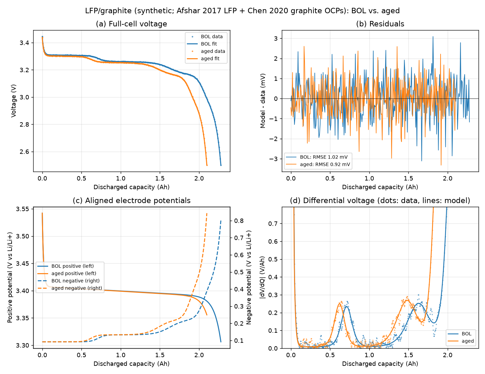
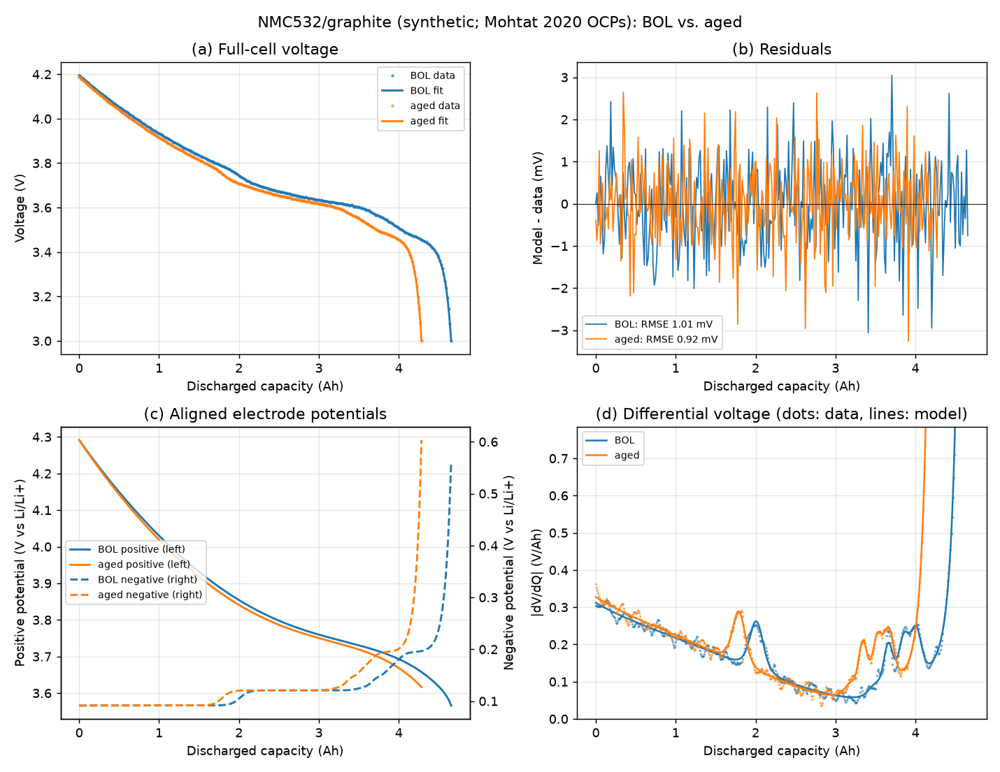

[README](../README.md) · [Skill](skill.md) · [MCP](mcp.md) · [CLI](cli.md) · [Python API](python-api.md) · [Examples](examples.md) · [Method](method.md) · [Glossary](../GLOSSARY.md)

# Worked examples

Both cells are synthetic and have the same ground-truth ageing: **LLI 8 %,
LAM_PE 5 %, LAM_NE 6 %**. The offset grows from 5 to 12 mV, the voltage noise
is 1 mV, and each curve has 300 points. The end of discharge is limited by the
negative electrode in both cells. Final interval = correlation-corrected profile
interval +/- bias budget (half-cell curves perturbed by +/-3 mV offset and 2 mV
shape error, 8 draws). A mode is identifiable if the half-width is at most 1
percentage point.

### LFP/graphite (headline)

`python examples/quickstart.py`. OCPs: LFP from Afshar et al. 2017 and graphite
from Chen et al. 2020 (the pairing of the PyBaMM `Prada2013` set). BOL capacities
are Q_PE 2.5 Ah, Q_NE 2.75 Ah and n_Li 2.4125 Ah. The rest voltage is 3.45 V
and the discharge runs to 2.5 V.

| Mode | Fitted | True | Final interval | Verdict |
|---|---|---|---|---|
| LLI | 8.01 % | 8.00 % | [7.87, 8.16] % | identifiable |
| LAM_PE | 4.76 % | 5.00 % | [-11.7, 21.1] % | **not identifiable** |
| LAM_NE | 6.05 % | 6.00 % | [5.53, 6.58] % | identifiable |

Over 10 noise seeds: LLI 8.00 +/- 0.02 %, LAM_PE 5.06 +/- 0.26 %, LAM_NE 6.02 +/- 0.09 %.

**Interpretation.** LLI and LAM_NE are well determined. The graphite staging
transitions (the two dV/dQ peaks in panel d) fix the scale and position of the
negative electrode. LAM_PE is recovered well when only noise is present (the
profile interval alone is about +/-0.7 pp). However, the LFP plateau falls by
only about 20 mV over the whole lithiation range, and in this negative-limited
cell the steep lithiated end of the LFP curve is never reached. A few mV of
error in the reference curve can therefore mimic a large change in positive
capacity, so the bias budget for LAM_PE is about 16 pp. **Report LAM_PE as an
interval for such LFP cells.** If the discharge does reach the LFP end (a
positive-limited cell), LAM_PE becomes identifiable again with a bias below
0.1 pp (see `tests/test_lfp_identifiability.py`).

### NMC532/graphite

`python examples/quickstart.py --chemistry nmc532`. OCPs from Mohtat et al.
2020. BOL capacities are Q_PE 5.0 Ah, Q_NE 5.5 Ah and n_Li 4.875 Ah. The rest
voltage is 4.2 V and the discharge runs to 3.0 V.

| Mode | Fitted | True | Final interval | Verdict |
|---|---|---|---|---|
| LLI | 8.00 % | 8.00 % | [7.95, 8.05] % | identifiable |
| LAM_PE | 4.97 % | 5.00 % | [4.67, 5.26] % | identifiable |
| LAM_NE | 6.00 % | 6.00 % | [5.49, 6.51] % | identifiable |

Over 10 noise seeds: LLI 8.00 +/- 0.00 %, LAM_PE 4.98 +/- 0.07 %, LAM_NE 5.99 +/- 0.11 %.

**Interpretation.** The sloping NMC potential carries information about the
positive capacity across the whole window, so all three modes are identifiable.
LAM_NE has the widest interval, because the graphite end of the curve is the
steep, sparsely sampled end of discharge.

Further examples: [`examples/cathode_fixed.py`](../examples/cathode_fixed.py) runs
the 3-parameter method on NMC811/graphite
([figure](images/cathode_fixed.png)), and
[`examples/blended_cathode.py`](../examples/blended_cathode.py) fits an NMC811 +
LFP blend.
